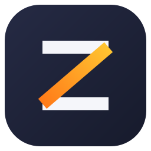
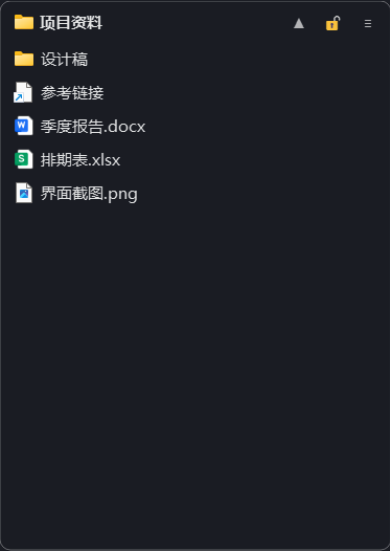
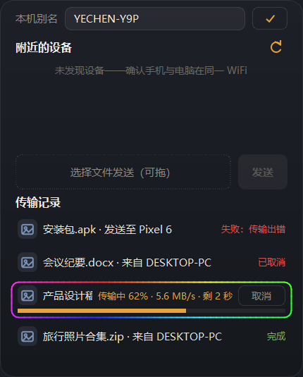
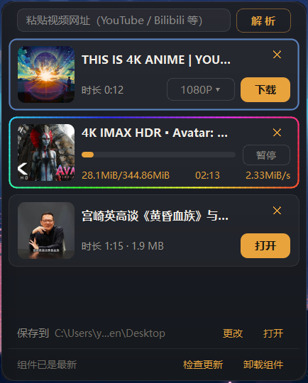



  

<h1 align="center">Zbox</h1>

  
  
  
  

  <b>English</b> | <a href="README.zh-CN.md">简体中文</a>

A Windows desktop organizer: desktop boxes + a floating panel (calendar / todo / LAN transfer / video downloader) + screenshot tool. Windows 10 / 11.

## Features

<table>
  <tr>
    <th align="center">Desktop Boxes</th>
    <th align="center">File Transfer</th>
    <th align="center">Video Downloader</th>
  </tr>
  <tr>
    <td></td>
    <td></td>
    <td></td>
  </tr>
</table>

1. **Desktop organization**: drag files into a box to tidy them away — icons are hidden and restored automatically, and the positions of icons that never entered a box are remembered and put back on launch.
   Drag a box near another visible box to snap matching edges: left-to-left, right-to-right, top-to-top, or bottom-to-bottom. Opposite edges never snap. The same rule applies while resizing a box and when moving the calendar panel; calendar resizing stays freely resizable. The snap engages within 8 px, releases after 12 px, and blue guides span both cards for every aligned edge.
   Inside a box, drop onto the white guide line between items for a custom order, onto a folder to move files into it, or onto an app/shortcut to open the dragged files with it.
   The collapse, lock, and menu icons stay hidden until the pointer enters the title bar, then fade in and fade out after it leaves.
2. **Floating panel**:
   - **Calendar**: clock with countdowns, public holidays and lunar calendar, scroll to flip months
   - **Todo**: check items off (grayed out), overdue reminders (pick a date, then confirm), dated items first and sorted by due date, undated items after them, and completed items last; editing or checking does not jump the list, and the editor has a check button to save. Right-click to edit/copy/delete with stacked 5-second undo toasts, each with its own countdown; new inputs start at the list tail, and the editor grows to show all content (Enter saves, Shift+Enter adds a line)
   - **Transfer**: send files and folders between devices on the LAN (folders arrive as a recreated directory tree on the receiver), with manual accept on the receiver (allow the Windows Firewall prompt when first enabling it; if you clicked "Cancel" by mistake and devices/files stop arriving, the transfer tab detects it and offers a one-click repair)
   - **Video downloader**: paste a URL to download videos, multiple resolutions, resumable downloads
   - Freely resize the card by dragging its edges/corners; the size is remembered
3. **Screenshot**: global hotkey region capture with rectangles, ellipses, QQ-style arrows, sequential number markers with auto-growing multiline dark labels and text, pin-to-screen and scrolling long capture; per-tool size sliders are remembered across captures, labels can be dragged and reopened for editing, and clicking or dragging a pinned image opens its fixed bottom toolbar tray for annotation, saving and copying; click elsewhere to dismiss it
4. **Languages**: the PC app and Android app support **Simplified Chinese and English**. On PC, choose the language under **Settings → Language** (a restart applies it); the installer's first page also lets you pick the installation language. On Android, switch it in the **Settings** tab at the bottom; it applies immediately.

## Quick Start

Download `zbox-Setup-v<version>-x64.exe` from [Releases](https://github.com/evachxji/zbox/releases) and double-click to open the installer. It installs for all users into `Program Files` (Windows asks for administrator permission), removes any previous Zbox program files first, and always keeps your personal data in `%APPDATA%\zbox`.

Upgrading: "Check for updates" in the bottom-right corner of the Settings window compares against the latest GitHub release and can download the installer and guide you through the upgrade.

Run from source: double-click `run.cmd` (it will offer to install PySide6 if missing).

## Build It Yourself

- One-click, three platforms: double-click `build.cmd` and pick 1-7 to build a single target or a combination (default 7 = everything: Windows exe installer + Android APK + HarmonyOS HAP). Artifacts (versioned file names) are collected in `dist\release\`.
  - Requirements: PC builds need PySide6 + PyInstaller (auto-install offered if missing); Android needs JDK 17 and the Android SDK; HarmonyOS needs DevEco Studio and `devecocli` (`npm i -g @deveco/deveco-cli@stable`)
  - The HAP is an unsigned debug package that only installs on emulators / developer debug devices; distributing to real devices requires signing or AppGallery release (see `harmony\README.md`)

## Verification

- `python -m unittest discover -s tests -v` — Python/UI regression tests
- `python transfer_selftest.py` — transfer protocol self-test (`SELFTEST OK`)
- `cd android && gradlew.bat testDebugUnitTest` — Android language-rule unit tests
- Bilingual screenshot self-check (renders every UI scene and exits):
  `set ZBOX_SHOT=designs\verify-en` + `set ZBOX_SHOT_LANG=en-US` + `python main.pyw` (use `zh-CN` for Chinese).
  Screenshot runs use an isolated IPC name, so they do not disturb a running panel.

## Compatibility

PySide6 (Qt 6.8 LTS), Python 3.10+, Windows 10 / 11.

## Acknowledgments

The LAN transfer feature implements the v2 protocol of the open-source project [LocalSend](https://github.com/localsend/localsend) (Apache License 2.0) as a private instance (port 53327 / multicast 224.0.0.168) and is not interoperable with the official LocalSend apps.
Video downloading is powered by [yt-dlp](https://github.com/yt-dlp/yt-dlp), with audio/video merging by [ffmpeg](https://ffmpeg.org/).

## Links

- 🌐 Website: [zbox.wzyjc.cn](https://zbox.wzyjc.cn)
- 📦 Releases: [github.com/evachxji/zbox/releases](https://github.com/evachxji/zbox/releases)
- 🐛 Issues: [github.com/evachxji/zbox/issues](https://github.com/evachxji/zbox/issues)
- 💬 LINUX DO Community: [linux.do](https://linux.do)

## License

[MIT](LICENSE)
