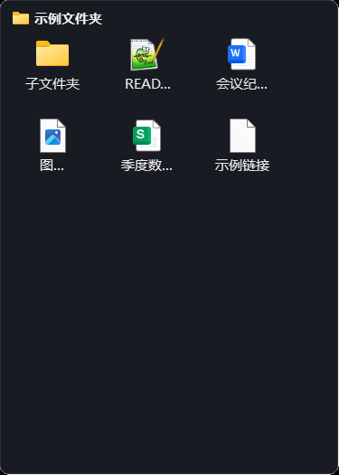
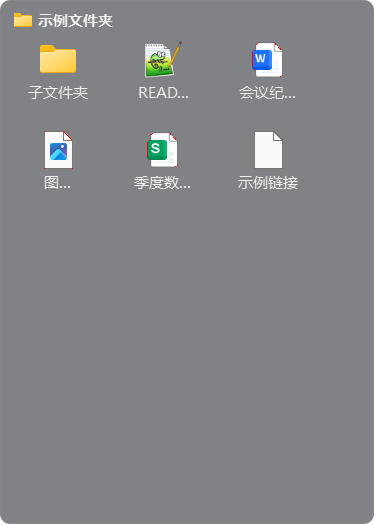

# 截图前后对比报告

- before：`D:\Document\code\zbox\perf-audit\shots_before`
- after：`D:\Document\code\zbox\perf-audit\shots_after`
- 场景数：61；完全一致：59；有差异/异常：2
- 残差口径：差异像素占比 ≤0.05% 且仅沿字形边缘（看差异高亮图确认）

| 场景 | 结果 | 差异像素 | 占比 | 最大通道差 |
| --- | --- | --- | --- | --- |
| box_collapsed | ✅ 完全一致 | 0 | 0% | 0 |
| box_confirm | ✅ 完全一致 | 0 | 0% | 0 |
| box_icon | ⚠️ 残差 | 66 | 0.0335% | 1 |
| box_invalid | ✅ 完全一致 | 0 | 0% | 0 |
| box_list | ✅ 完全一致 | 0 | 0% | 0 |
| box_locked | ✅ 完全一致 | 0 | 0% | 0 |
| box_menu | ✅ 完全一致 | 0 | 0% | 0 |
| box_rename | ✅ 完全一致 | 0 | 0% | 0 |
| mica_about | ✅ 完全一致 | 0 | 0% | 0 |
| mica_cal | ✅ 完全一致 | 0 | 0% | 0 |
| mica_due_popup | ✅ 完全一致 | 0 | 0% | 0 |
| mica_holiday_import | ✅ 完全一致 | 0 | 0% | 0 |
| mica_holiday_info | ✅ 完全一致 | 0 | 0% | 0 |
| mica_icons_menu | ✅ 完全一致 | 0 | 0% | 0 |
| mica_mobile_guide | ✅ 完全一致 | 0 | 0% | 0 |
| mica_recv_dialog | ✅ 完全一致 | 0 | 0% | 0 |
| mica_settings | ✅ 完全一致 | 0 | 0% | 0 |
| mica_time_popup | ✅ 完全一致 | 0 | 0% | 0 |
| mica_titlebar | ✅ 完全一致 | 0 | 0% | 0 |
| mica_toast_fail | ✅ 完全一致 | 0 | 0% | 0 |
| mica_toast_ok | ✅ 完全一致 | 0 | 0% | 0 |
| mica_todo | ✅ 完全一致 | 0 | 0% | 0 |
| mica_todo_edit | ✅ 完全一致 | 0 | 0% | 0 |
| mica_todo_undo | ✅ 完全一致 | 0 | 0% | 0 |
| mica_transfer | ✅ 完全一致 | 0 | 0% | 0 |
| mica_transfer_busy | ✅ 完全一致 | 0 | 0% | 0 |
| mica_transfer_info | ✅ 完全一致 | 0 | 0% | 0 |
| mica_transfer_records | ✅ 完全一致 | 0 | 0% | 0 |
| mica_video | ✅ 完全一致 | 0 | 0% | 0 |
| mica_video_info | ✅ 完全一致 | 0 | 0% | 0 |
| mica_video_parsed | ✅ 完全一致 | 0 | 0% | 0 |
| nocturne_about | ✅ 完全一致 | 0 | 0% | 0 |
| nocturne_cal | ✅ 完全一致 | 0 | 0% | 0 |
| nocturne_due_popup | ✅ 完全一致 | 0 | 0% | 0 |
| nocturne_holiday_import | ✅ 完全一致 | 0 | 0% | 0 |
| nocturne_holiday_info | ✅ 完全一致 | 0 | 0% | 0 |
| nocturne_icons_menu | ✅ 完全一致 | 0 | 0% | 0 |
| nocturne_mobile_guide | ✅ 完全一致 | 0 | 0% | 0 |
| nocturne_recv_dialog | ✅ 完全一致 | 0 | 0% | 0 |
| nocturne_settings | ✅ 完全一致 | 0 | 0% | 0 |
| nocturne_time_popup | ✅ 完全一致 | 0 | 0% | 0 |
| nocturne_titlebar | ✅ 完全一致 | 0 | 0% | 0 |
| nocturne_toast_fail | ✅ 完全一致 | 0 | 0% | 0 |
| nocturne_toast_ok | ✅ 完全一致 | 0 | 0% | 0 |
| nocturne_todo | ✅ 完全一致 | 0 | 0% | 0 |
| nocturne_todo_edit | ✅ 完全一致 | 0 | 0% | 0 |
| nocturne_todo_undo | ⚠️ 残差 | 4 | 0.0025% | 132 |
| nocturne_transfer | ✅ 完全一致 | 0 | 0% | 0 |
| nocturne_transfer_busy | ✅ 完全一致 | 0 | 0% | 0 |
| nocturne_transfer_info | ✅ 完全一致 | 0 | 0% | 0 |
| nocturne_transfer_records | ✅ 完全一致 | 0 | 0% | 0 |
| nocturne_video | ✅ 完全一致 | 0 | 0% | 0 |
| nocturne_video_info | ✅ 完全一致 | 0 | 0% | 0 |
| nocturne_video_parsed | ✅ 完全一致 | 0 | 0% | 0 |
| pin_window | ✅ 完全一致 | 0 | 0% | 0 |
| wizard_install_p1 | ✅ 完全一致 | 0 | 0% | 0 |
| wizard_install_p2 | ✅ 完全一致 | 0 | 0% | 0 |
| wizard_install_p3 | ✅ 完全一致 | 0 | 0% | 0 |
| wizard_uninstall_p1 | ✅ 完全一致 | 0 | 0% | 0 |
| wizard_uninstall_p2 | ✅ 完全一致 | 0 | 0% | 0 |
| wizard_uninstall_p3 | ✅ 完全一致 | 0 | 0% | 0 |

## 差异场景明细

### box_icon

| 前（PyQt5） | 后（PySide6） | 差异高亮 |
| --- | --- | --- |
|  |  |  |

### nocturne_todo_undo

| 前（PyQt5） | 后（PySide6） | 差异高亮 |
| --- | --- | --- |
|  |  |  |

